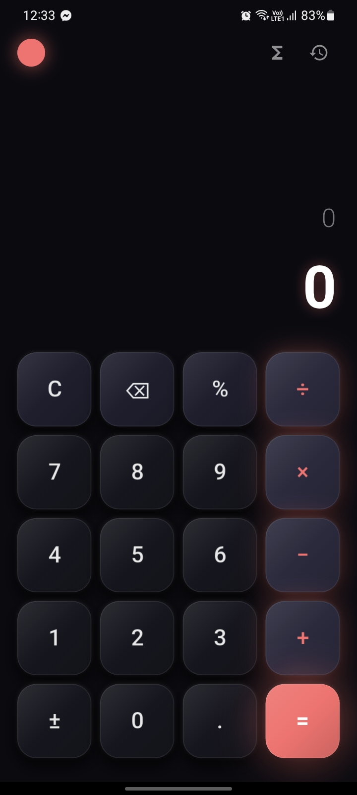
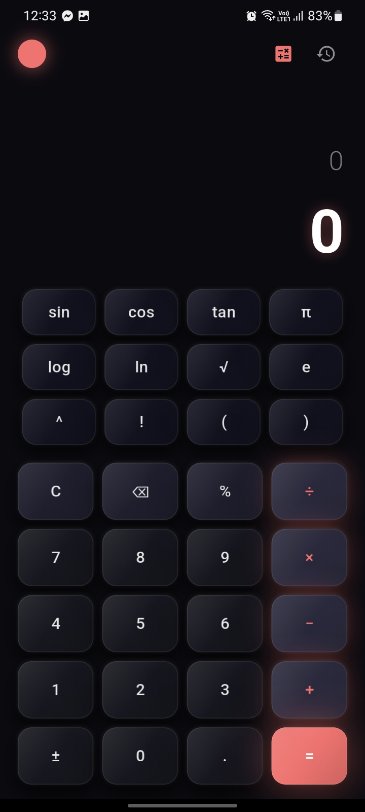
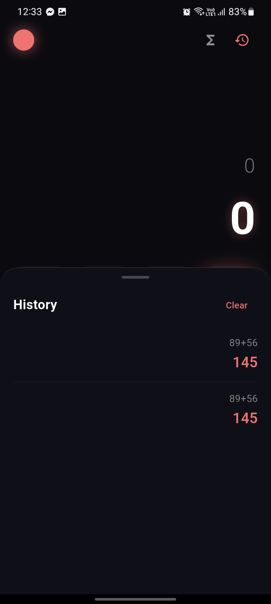

# 🧮 Neo Calc — 3D Animated Calculator

A minimal, smooth, and 3D animated calculator app built with **Flutter**.

<p align="center">
  
  
  
</p>

---

## ✨ Features

- 🎨 **3D Press Animation** — Buttons sink, rotate, and scale on tap with perspective transform
- 🌈 **5 Accent Themes** — Tap the colored circle to cycle (Purple, Cyan, Coral, Amber, Blue)
- 🧮 **Scientific Mode** — sin, cos, tan, log, ln, √, π, e, ^, !, (, )
- 📜 **History Panel** — Persistent storage of last 50 calculations
- 📳 **Haptic Feedback** — Vibration on every button press
- 🎬 **Splash Screen** — Elastic animation with ∑ symbol
- 🌙 **Minimal Dark UI** — Beautiful dark theme with smooth animations
- 💾 **Theme Persistence** — Your accent choice is saved between sessions

---

## 📱 Screenshots

| Main UI | Scientific Mode | History |
|---------|-----------------|---------|
|  |  |  |

---

## 🛠️ Tech Stack

- **Flutter** 3.47+
- **Dart** 3.13+
- [math_expressions](https://pub.dev/packages/math_expressions) — Expression parsing
- [flutter_animate](https://pub.dev/packages/flutter_animate) — Smooth animations
- [shared_preferences](https://pub.dev/packages/shared_preferences) — Persistent storage
- [google_fonts](https://pub.dev/packages/google_fonts) — Beautiful typography

---

## 📥 Download APK

[](https://github.com/developeroption14/neo_calc/releases/latest)

Or build from source:

```bash
flutter build apk --release --split-per-abi
```

---

## 🚀 Installation

```bash
git clone https://github.com/developeroption14/neo_calc.git
cd neo_calc
flutter pub get
flutter run
```

---

## 📦 Build APK

```bash
flutter build apk --release --split-per-abi
```

The APK will be generated at:

- `build/app/outputs/flutter-apk/app-arm64-v8a-release.apk` (Modern phones)
- `build/app/outputs/flutter-apk/app-armeabi-v7a-release.apk` (Older phones)

---

## 📂 Project Structure

```
lib/
├── main.dart                    # Entry point
├── theme/
│   └── app_theme.dart           # Color palette
├── services/
│   ├── history_service.dart     # History persistence
│   └── haptic_service.dart      # Vibration control
├── models/
│   └── history_item.dart        # History data model
├── widgets/
│   ├── calc_button.dart         # 3D animated button
│   ├── display.dart             # Input/result display
│   └── history_panel.dart       # History bottom sheet
└── screens/
    ├── splash_screen.dart       # Animated splash
    └── calculator_screen.dart   # Main calculator
```

---

## 🎨 How to Use

- **Basic calculation:** Type `7 + 6 =` → result `13`
- **Change theme:** Tap the colored circle (top-left corner)
- **Scientific mode:** Tap the `ƒ` icon (top-right)
- **View history:** Tap the `🕐` icon (top-right)
- **Delete last digit:** Tap `⌫`
- **Clear all:** Tap `C`

---

## 👨‍💻 Author

**shrabon** — [@developeroption14](https://github.com/developeroption14)

---

## 📄 License

This project is open source and available under the **MIT License**.

---

⭐ If you like this project, give it a star!
